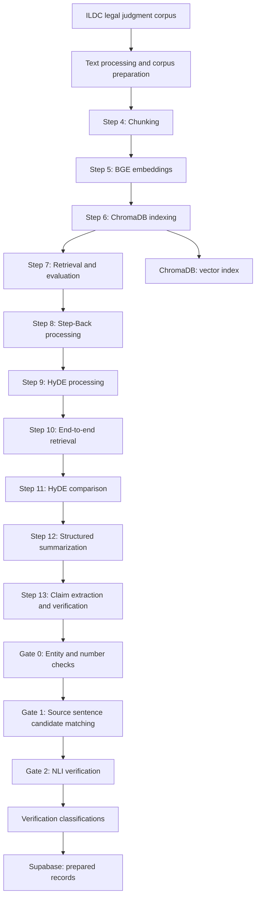
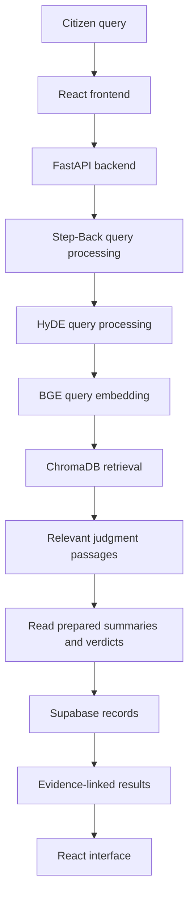

# PRAMĀṆA
### Evidence-Verified Retrieval and Claim Verification for Indian Supreme Court Judgments

**A citizen-oriented legal information research prototype**

> **In 10 seconds:** PRAMĀṆA processes a curated corpus of 538 Indian Supreme Court judgments, generates structured summaries for 225 cases, and evaluates 3,362 extracted claims through a three-gate verification pipeline. The recorded classifications are 686 verified, 2,155 needing review, and 521 blocked. Retrieval achieved 1.000 Recall@5 on a small, source-derived 25-query benchmark. The verification gates did **not** meet their original acceptance targets (`gate2_passed: false`). This is a research prototype, not a validated legal system, and not legal advice.

**Contents:**
[What it is](#1-what-the-project-is) · [Scope](#2-project-scope) · [Components](#3-what-the-system-does) · [Architecture](#4-system-architecture) · [Dataset](#5-dataset-construction) · [Verification gates](#6-three-gate-claim-verification) · [Calibration](#7-calibration-methodology-and-limitations) · [Results](#8-retrieval-and-experimental-results) · [Built / failed / remaining](#9-what-was-built-what-failed-and-what-remains) · [Stack](#10-technology-stack) · [Repository](#11-repository-structure) · [API](#12-api-endpoints) · [Setup](#13-installation-and-setup) · [Data](#14-database-and-data-availability) · [Security](#15-security-and-responsible-use) · [Limitations](#17-limitations-and-future-work) · [Authors](#18-authors-and-project-supervision) · [Citation](#20-citation)

---

## 1. What the Project Is

*Pramāṇa* is a Sanskrit word for a valid means of knowledge. The project began from a real situation: a family member faced an unpaid-loan dispute and had no affordable way to understand what Indian courts had decided in similar cases.

PRAMĀṆA investigates how AI can help ordinary citizens understand relevant Supreme Court judgments **without treating generated explanations as automatically trustworthy**.

Legal judgments contain facts, evidence, arguments, reasoning and outcomes, and their length and terminology make them hard for people without legal training. A language model can simplify such text, but it can also omit important facts, misrepresent a judgment, or state things the source does not support.

PRAMĀṆA combines:

- Semantic retrieval of relevant judgments.
- Structured, plain-language summarization of court decisions.
- Sentence-level claim extraction.
- Source-based factual checks.
- Natural Language Inference (NLI) for claim verification.
- Explicit classification of each claim as verified, needing review, or blocked.

The central question is:

**Can an AI-generated explanation of a legal judgment be made more transparent by checking individual claims against the original source before presenting them to a citizen?**

PRAMĀṆA does not predict judicial outcomes or provide legal advice.

## 2. Project Scope

The domain was deliberately narrowed to **money-lending and cheque-bounce disputes, including disputes involving Section 138 of the Negotiable Instruments Act, 1881 (India)**.

An old unpaid debt and a live cheque-bounce prosecution are different legal situations, so the prototype treats them as related but does not conflate them. It retrieves and explains judgments; it does not decide whether a particular citizen will win a case.

## 3. What the System Does

| Component | Function |
|---|---|
| Legal corpus preparation | Filters, cleans and prepares judgments |
| Text chunking | Splits judgments into retrieval passages |
| Embedding generation | Converts passages into semantic vectors |
| ChromaDB retrieval | Finds relevant judgment passages |
| Step-Back processing | Rewrites a plain-language question into legal terms and checks the domain |
| HyDE | Generates hypothetical legal-style context for query retrieval |
| Structured summarization | Produces citizen-oriented judgment summaries |
| Claim extraction | Separates summaries into individual claims |
| Three-gate verification | Evaluates each claim against source evidence |
| React application | Presents results with verification status |
| FastAPI backend | Handles application requests |
| Supabase | Stores prepared application and evidence records |

## 4. System Architecture

PRAMĀṆA has two separate execution paths. The offline pipeline prepares judgments, summaries and verification records. The live application processes a user query, retrieves relevant passages, and reads the prepared records.

### 4.1 Offline processing pipeline (Steps 4 to 13)



### 4.2 Live application path



**Architecture distinction:** the live path does not regenerate summaries or rerun the verification gates for each query. Summaries and verification outcomes are prepared offline and stored for application use.

## 5. Dataset Construction

### Source corpus

The primary source is the **Indian Legal Documents Corpus (ILDC)**, obtained through Hugging Face. ILDC judgments were sourced through Indian Kanoon, not directly from the official Supreme Court website, so one intermediary layer exists.

| Dataset stage | Count |
|---|---:|
| Original ILDC judgments | 34,816 |
| Curated final judgments | 538 |
| Structured case summaries | 225 |
| Extracted claim sentences | 3,362 |

These counts are outputs of different pipeline stages. They do not mean 538 fully verified judgments or a one-to-one mapping between judgments, summaries and claims.

### Corpus preparation

The corpus was not built with a single keyword filter:

1. Start from 34,816 Supreme Court judgments.
2. Refine domain selection through six successive classifier versions.
3. Review false positives such as tax, tenancy, criminal-appeal, cooperative-society, company-law, estate-duty and stamp-duty cases.
4. Discover systematic text corruption by reading actual samples: `company` / `com` appearing where `con` was expected (producing forms such as "companyrt").
5. Repair the text with a controlled, corpus-derived repair map. This repair was not independently validated against every original judgment.
6. Manually remove two out-of-domain cases that passed the classifier.
7. Retain 538 judgments.

### Summary provenance

The 225 structured case summaries came from several sources: 52 written by hand as a quality reference, 87 generated with DeepSeek, and 86 generated with Manus. ChatGPT was used as an independent checker across all 225, and five evidence fields were corrected manually. **No qualified legal expert reviewed the summaries and no inter-annotator agreement statistic was calculated.** The claims verified by the gates are therefore claims in AI-assisted summaries.

### Chunking and embeddings

| Component | Configuration |
|---|---|
| Embedding model | `BAAI/bge-small-en-v1.5` (384 dimensions) |
| Vector database | ChromaDB, collection `pramana_v14` |
| Chunking | Sentence-boundary based, about 300–500 words |
| Token ceiling | 512 tokens |
| Citation support | Character offsets preserved |

The final retrieval evaluation reports 4,855 ChromaDB chunks.

**Data licensing:** the licence and redistribution status of the source material must be confirmed. The private corpus and local vector index are not distributed in this repository.

## 6. Three-Gate Claim Verification

The three-gate pipeline is the central technical component. Instead of treating a generated summary as one answer, the system splits it into claims and evaluates each against the cited source text.

### Gate 0: Entity and number verification

**Purpose:** detect unsupported changes to specific facts.

Gate 0 checks dates, amounts, section numbers and party names in a generated sentence against the source. Its recorded block rate was 0.65% of the 3,362 sentences, after two regex iterations to correct formatting-related false positives. It catches explicit factual mismatches and does not establish that a whole sentence is semantically correct.

### Gate 1: Cosine span matching

**Purpose:** find the closest supporting source sentence.

The original design used cosine similarity as a blocking mechanism. Calibration showed it could not reliably meet the precision requirement for plain-language paraphrases of legal text; **best reported precision was 59.6%**. Gate 1 was therefore redesigned as a **source-sentence candidate finder** that passes its candidate to Gate 2 and does not decide truth by itself. This redesign happened after the full architecture had been built.

### Gate 2: Natural Language Inference

**Purpose:** decide whether the candidate source sentence supports, contradicts or fails to establish the claim.

| Configuration | Value |
|---|---|
| Model | `cross-encoder/nli-deberta-v3-small` |
| Method | NLI with softmax over model logits |
| Entailment threshold | 0.35 |
| Contradiction threshold | 0.50 |

- **Verified:** the evidence meets the configured entailment criteria.
- **Needs review:** the evidence is insufficient or uncertain.
- **Blocked:** the claim meets the configured contradiction criteria.

These are model-assisted classifications, not legal determinations.

### Aggregate results

Recorded classifications across 3,362 extracted claims from 225 prepared case summaries:

| Classification | Count | Percentage |
|---|---:|---:|
| Verified | 686 | 20.4% |
| Needs review | 2,155 | 64.1% |
| Blocked | 521 | 15.5% |
| **Total** | **3,362** | **100%** |

By design, Gate 1 does not block; Gate 0 accounts for 0.65% of sentences, so the remaining blocks come from Gate 2. A blocked claim is one that failed the configured checks. It does **not** prove the claim is false, and it should not be read as "hallucinations caught". A verified claim is a model-assisted result, not proof of correctness.

### Gate 2 acceptance targets

| Metric | Target |
|---|---:|
| Precision | 98% |
| Recall | 90% |
| False-positive rate | 2% |
| F1 score | 0.93 |

Gate 2 reached approximately 78% precision at its best and did not satisfy the acceptance criteria. The project records `gate2_passed: false`. The gates must not be described as fully validated or production-ready.

## 7. Calibration Methodology and Limitations

The Gate 1 calibration set contained 300 claim-source pairs. Labels were produced by four AI evaluators: two Claude and two ChatGPT. **This was not expert legal annotation.** No qualified legal expert took part, and no formal inter-annotator agreement was calculated. The results informed the redesign of Gate 1 but do not establish legal ground truth.

## 8. Retrieval and Experimental Results

These results belong to specific evaluation runs. They are not a single end-to-end accuracy score.

### 8.1 Baseline retrieval

The Step 7B (V14) evaluation used 538 judgments, 4,855 ChromaDB chunks and 25 manually verified gold queries (18 direct, 7 partial). The 25 queries were **selected from 50 source-derived candidates**, so they are likely easier and more closely aligned with the corpus than spontaneous questions from real citizens.

| Retrieval metric | Result |
|---|---:|
| Case-level Recall@1 / @5 / @10 | 0.960 / 1.000 / 1.000 |
| Chunk-level Recall@1 / @5 / @10 | 0.960 / 1.000 / 1.000 |
| Chunk-level MRR | 0.980 |

Recall@5 is a retrieval metric, not overall accuracy, and it applies to this benchmark only.

### 8.2 HyDE comparison

HyDE generates a hypothetical legal-style passage to bridge the vocabulary gap between a citizen's question and judgment language. **HyDE reduced Recall@5 from 1.000 to 0.840.** This negative result is reported as found. HyDE is retained as a language-normalisation step, not as a retrieval improvement.

### 8.3 Step-Back and domain checking

The Step-Back and domain-check component was tested on 30 queries (12 with Gemini, 18 with Groq) and classified all of them correctly. Because two different models were used, this is an engineering check, not a single-model benchmark.

## 9. What Was Built, What Failed, and What Remains

### Built

- A curated corpus of 538 Supreme Court judgments with a documented cleaning workflow.
- Sentence-boundary chunking, BGE embeddings and a persistent ChromaDB index.
- Retrieval and evaluation scripts, Step-Back and HyDE components, and the HyDE comparison.
- Structured summaries for 225 cases and extraction of 3,362 claims.
- A three-gate verification workflow with per-sentence source traceability.
- Supabase storage for prepared case, claim and evidence records.
- A React and TypeScript frontend and a FastAPI backend.

### Did not meet expectations

- HyDE reduced Recall@5 from 1.000 to 0.840.
- Gate 1 reached only 59.6% best precision and could not be used as a blocker.
- Gate 2 reached about 78% precision and did not pass its acceptance criteria (`gate2_passed: false`).
- Only 20.4% of claims were fully verified; 64.1% remained "needs review".
- The retrieval benchmark is small and source-derived.
- Calibration labels came from AI evaluators, not legal experts.

### Not complete

- I did not measure whether the gates reduce unsupported sentences compared with an ungated summary.
- No evaluation by qualified legal experts, and no inter-annotator agreement.
- No independently collected set of realistic citizen questions.
- Hindi and Telugu support are future work.
- No automated test suite or CI is included.
- Fresh-clone installation has not been tested, and a complete end-to-end run from a fresh clone has not been established.
- The Supabase schema and records are not published, and the app cannot run end to end without compatible records and a prepared ChromaDB index.
- Source-data licensing and redistribution permissions remain to be confirmed.
- Production-scale reliability, security and performance have not been established.

## 10. Technology Stack

| Layer | Technology |
|---|---|
| Language | Python 3.11.9, TypeScript |
| Frontend | React, TypeScript, Vite |
| Backend | FastAPI, Uvicorn |
| Embedding model | `BAAI/bge-small-en-v1.5` |
| Vector database | ChromaDB |
| NLI model | `cross-encoder/nli-deberta-v3-small` |
| Query processing | Step-Back prompting, HyDE (Groq) |
| Database | Supabase PostgreSQL |
| Version control | Git, GitHub |

**Development environment:** Python 3.11.9 on the author's Windows 10 AMD64 machine, CPU only (no GPU). This is not a claim of successful fresh-machine installation.

## 11. Repository Structure

```text
PRAMANA/
│
├── frontend/
│   ├── public/assets/        interface artwork and opening-sequence assets
│   ├── src/
│   │   ├── api.ts
│   │   ├── main.ts
│   │   └── style.css
│   ├── index.html
│   ├── package.json
│   ├── package-lock.json
│   ├── tsconfig.json
│   └── vite.config.ts        development proxy to the local API
│
├── api.py                    FastAPI application (/health, /search, /cases/{id})
├── public_host.py            serves the built frontend with the API
├── check_environment.py      environment diagnostic
├── requirements.txt
├── .env.example
├── .gitignore
├── .gitattributes
├── LICENSE
├── CITATION.cff
├── README.md
│
├── step4_chunker.py
├── step5_embeddings_v14.py
├── step6_chromadb_v14.py
├── step7a_retrieval_v14.py
├── step7b_eval.py
├── step8_stepback.py
├── step9_hyde.py
├── step10_e2e.py
├── step11_hyde_comparison.py
├── step12_summarization.py
├── step12B_full_production.py
├── step13a_gate0_corrected.py
└── step13_complete.py
```

Only one version of each step is published. The private corpus, generated private datasets, the local ChromaDB index, credentials and runtime files are intentionally excluded.

## 12. API Endpoints

| Endpoint | Purpose |
|---|---|
| `GET /health` | Backend health check |
| `POST /search` | Submit a legal search query (rejects out-of-scope queries) |
| `GET /cases/{id}` | Retrieve a prepared case record |

`api.py` locates the Step 8, 9 and 10 modules at startup by the functions they define. The endpoints depend on the required configuration and backing data. Their presence does not imply that this repository contains a ready-to-use database.

## 13. Installation and Setup

### Prerequisites

- Python 3.11
- Node.js and npm
- Git (and Git LFS if you want the optional opening-sequence video; see below)
- A configured Supabase project with compatible prepared records
- A compatible ChromaDB index
- Groq API credentials for workflows that call Groq

### Clone

```bash
git clone https://github.com/KollaGnanadeep/PRAMANA.git
cd PRAMANA
```

The opening-sequence video `frontend/public/assets/revese-video.mp4` is tracked with Git LFS. Without Git LFS the file is only a small pointer and the interface skips the video. To fetch it: `git lfs install && git lfs pull`.

### Python environment

```powershell
python -m venv .venv
.venv\Scripts\activate
python -m pip install --upgrade pip
pip install -r requirements.txt
```

### Environment variables

Create a local `.env` from `.env.example`.

| Variable | Purpose | Requirement |
|---|---|---|
| `SUPABASE_URL` | Supabase project URL | Required for database-backed features |
| `SUPABASE_SERVICE_ROLE_KEY` | Server-side Supabase key | Required for service-role operations |
| `GROQ_API_KEY` | Groq API key | Required only for workflows that call Groq |
| `VITE_API_BASE_URL` | API address used by the frontend | Optional; empty by default, so the Vite dev proxy is used |

The service-role key must stay on the server. Never expose it through a frontend variable or commit it. Individual scripts may need additional configuration.

### Frontend

```powershell
cd frontend
npm ci
npm run build
cd ..
```

### Run (development)

```powershell
python -m uvicorn api:app --reload --port 8000
```

In a second terminal: `cd frontend && npm run dev`. The Vite development server proxies `/search`, `/cases` and `/health` to `http://127.0.0.1:8000`.

### Run (production-style, frontend and API together)

```bash
uvicorn public_host:app --host 0.0.0.0 --port $PORT
```

This requires a built frontend in `frontend/dist` and raises an error at startup if it is missing.

### Reproducibility warning

**Fresh-clone installation has not been tested.** The commands describe the intended workflow. They do not establish that a new user can reproduce the full application without preparing the external services, database records and ChromaDB index. A successful frontend build or backend start alone does not show that the retrieval and verification workflow works end to end.

## 14. Database and Data Availability

The Supabase schema and records are **not** published in this repository. The project database held prepared case information, claims, gate results and related evidence:

- 10 PostgreSQL tables
- 225 prepared case records and 3,362 claim records
- Gate 0, Gate 1 and Gate 2 records
- 1,125 case sections and 1,236 source chunks, plus pipeline metadata

These are recorded project outputs and not files in this repository. The database's source chunks and the ChromaDB index's 4,855 chunks come from different stores and are not expected to match. A new user must obtain or recreate the schema and records before the full application can operate.

## 15. Security and Responsible Use

The public repository excludes real `.env` files and credentials, the private legal corpus, local ChromaDB indexes, private evaluation datasets and intermediate outputs, local environments and logs. `.env.example` contains placeholders only.

The API currently allows requests from any origin (open CORS), which is acceptable for local development only. Before any public deployment, restrict CORS, protect database access, add rate limits, and manage secrets properly.

Users must make sure their legal data sources are lawfully obtained and that their use complies with the applicable licences and terms.

## 16. Research Contributions

The project investigates these engineering contributions:

1. **Structured judgment decomposition:** organising judgment information into citizen-oriented summary fields.
2. **Semantic legal retrieval:** retrieving relevant passages with dense vectors.
3. **Citizen-oriented legal NLP:** presenting judgment information in a more accessible form.
4. **Three-gate claim verification:** entity and number checks, source-sentence candidate matching, and NLI.
5. **Evidence-linked output classification:** separating supported, uncertain and blocked claims.

The project does not claim these components are superior to existing systems. Their effectiveness needs broader, independent evaluation.

## 17. Limitations and Future Work

### Limitations

- The corpus covers one legal domain and 538 judgments.
- ILDC was sourced through Indian Kanoon rather than the official court site.
- The retrieval benchmark has 25 queries selected from 50 source-derived candidates (18 direct, 7 partial), which likely makes it easier than real citizen questions.
- The 300 calibration pairs were labelled by four AI evaluators, not legal experts, with no agreement statistic.
- Gate 1 and Gate 2 did not reach their targets; most claims need review.
- The effect of the gates against an ungated baseline has not been measured.
- Hindi and Telugu support are not implemented.
- Open CORS, no automated tests, and untested fresh-clone setup.
- The Supabase schema and records are not public, and source-data licensing remains to be confirmed.

### Future work

- Improve verification precision, recall and calibration; fine-tune NLI on Indian legal text.
- Compare the gates against an ungated summarization baseline.
- Add expert-reviewed calibration data and agreement measurements.
- Collect independent, realistic citizen questions for evaluation.
- Investigate hybrid retrieval and reranking.
- Add Hindi and Telugu support.
- Publish a reproducible database setup and authorised schema.
- Validate clean installation and deployment; add automated tests.
- Complete the legal-data licensing review.

These are planned directions, not current capabilities.

## 18. Authors and Project Supervision

**Author:** K. Gnanadeep
**Project guidance:** Dr. Kolluri David Raju
**Institution:** Hyderabad Institute of Technology and Management (HITAM), India

### AI assistance disclosure

AI-based tools (including Claude, ChatGPT, DeepSeek and Manus) were used for selected activities such as code assistance, debugging, summary generation, data checking and documentation. The author is responsible for the implementation, experimental methodology, interpretation of results and claims made in this repository. No AI tool is listed as an author.

## 19. Demonstration

A recorded walkthrough and screenshots of the application will be added to this section.

## 20. Citation

See [`CITATION.cff`](CITATION.cff); GitHub's "Cite this repository" button uses it. This is software citation metadata, not a peer-reviewed publication.

## 21. References

1. Malik, Sanjay, Nigam, Guha, Bhattacharya and Modi (2021). *ILDC for CJPE: Indian Legal Documents Corpus for Court Judgment Prediction and Explanation.* ACL-IJCNLP.
2. Gao, Ma, Lin and Callan (2023). *Precise Zero-Shot Dense Retrieval without Relevance Labels* (HyDE). ACL.
3. Karpukhin et al. (2020). *Dense Passage Retrieval for Open-Domain Question Answering.* EMNLP.
4. Reimers and Gurevych (2019). *Sentence-BERT: Sentence Embeddings using Siamese BERT-Networks.* EMNLP-IJCNLP.
5. Louis, Van Dijck and Spanakis (2024). *Interpretable Long-Form Legal Question Answering with Retrieval-Augmented Large Language Models.* AAAI.

These works give research background and do not imply that PRAMĀṆA reproduces their results.

## 22. Disclaimer

PRAMĀṆA is an academic research prototype for exploring evidence-aware retrieval and comprehension of Indian Supreme Court judgments. It does not provide legal representation, guarantee the correctness of generated interpretations, predict judicial outcomes, or replace advice from a qualified advocate. Consult the original judgment and a qualified legal professional before making legal decisions.

---

**PRAMĀṆA: evidence before explanation.**
