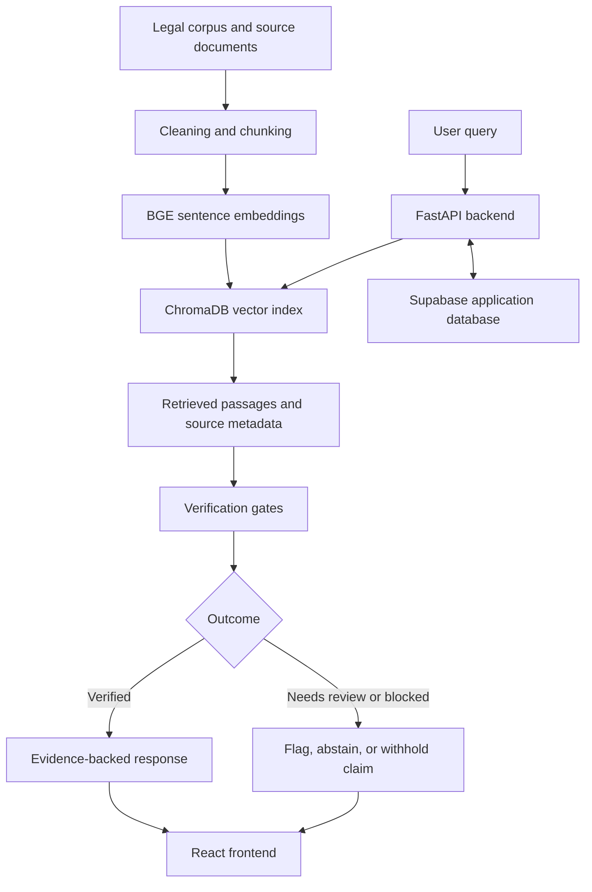

# PRAMANA

PRAMANA is a legal-evidence retrieval and claim-verification prototype designed to help users explore Indian legal materials with traceable supporting sources. Its pipeline prepares legal documents, splits them into chunks, generates embeddings, retrieves relevant passages from ChromaDB, and applies verification gates before evidence-backed content is presented through a React frontend and FastAPI backend. Supabase stores application records and verified legal evidence; ChromaDB serves as the vector-retrieval store. PRAMANA is a research prototype, not a substitute for a qualified lawyer or authoritative legal advice.

## System architecture



The diagram is a high-level logical view. Adapt it if the deployed implementation has different runtime connections.

## Main components

- **React + Vite frontend:** citizen-facing interface.
- **FastAPI backend:** API and orchestration layer (`api.py`).
- **ChromaDB:** vector index for semantic retrieval.
- **BGE embeddings:** vector representations used by the retrieval pipeline.
- **Supabase:** application records and verified legal evidence.
- **Verification gates:** checks that determine whether claims are verified, need review, or are blocked.
- **Groq:** used by selected generation/evaluation scripts where configured.

## Repository layout

The repository contains the application source and pipeline scripts. Local corpora, generated indexes, credentials, and large intermediate evaluation data are intentionally excluded.

Typical files include:

- `api.py`, `app.py` — backend/application entry points.
- `frontend/` — React/Vite source.
- `step*.py`, `v*.py`, and `scripts/` — processing, retrieval, evaluation, and verification scripts.
- `requirements.txt` — Python dependencies.

The exact set of scripts included in a public release should be reviewed before publishing.

## Installation

### Prerequisites

- Python version compatible with the pinned packages in `requirements.txt`.
- Node.js and npm compatible with the frontend's Vite/TypeScript versions.
- Supabase project credentials for database-backed features.
- Groq API key only if running scripts that call Groq.
- Access to the legal source corpus required by the selected pipeline stages.

### 1. Clone the repository

```bash
git clone https://github.com/KollaGnanadeep/PRAMANA.git
cd PRAMANA
```

### 2. Create and activate a Python environment

Windows PowerShell:

```powershell
python -m venv .venv
.\.venv\Scripts\Activate.ps1
python -m pip install --upgrade pip
pip install -r requirements.txt
```

If PowerShell blocks activation, use the appropriate Python executable directly from `.venv\Scripts\python.exe` rather than changing machine-wide execution policy.

### 3. Configure environment variables

Create a local `.env` file based on `.env.example`. Never commit `.env` or paste its contents into an issue or public discussion.

The Supabase service-role key must remain server-side. Do not place it in frontend variables or expose it through a `VITE_` variable.

### 4. Install and build the frontend

```powershell
cd frontend
npm ci
npm run build
cd ..
```

### 5. Start the API

From the repository root, after configuring the required environment variables:

```powershell
uvicorn api:app --reload
```

This command assumes `api.py` exposes the FastAPI instance as `app`. Confirm the entry point and required environment variables against the current source before deployment.

### 6. Run a pipeline stage

The repository contains stage-specific scripts. Inspect each script's inputs, output paths, model requirements, and expected corpus version before running it. The private/local `data/` directory and prebuilt ChromaDB indexes are not included in this public repository; users must obtain or prepare appropriately licensed source data and rebuild required artifacts.

## Evaluation results

Results below are copied from local QC reports and apply only to the named evaluation runs. They are not a single end-to-end accuracy score.

| Evaluation | Result | Scope / interpretation |
|---|---:|---|
| Retrieval Recall@1 | 0.960 (96.0%) | Reported Step 7 benchmark; 25 queries |
| Retrieval Recall@5 | 1.000 (100.0%) | Reported Step 7 benchmark; 25 queries |
| Retrieval Recall@10 | 1.000 (100.0%) | Reported Step 7 benchmark; 25 queries |
| Chunk-level MRR | 0.980 | Reported Step 7 benchmark |
| Step 7 retrieval QC | PASS | Local QC report |
| V14 retrieval QC | PASS | 10 successful queries; zero duplicate-result, malformed-result, or retrieval failures |
| Step 12 generation QC | 0 failures | Generation/integrity checks passed; this does not establish semantic accuracy |
| Step 13 final verification example | BLOCKED | Case `1990_340`: 3 verified, 16 needs-review, 4 blocked out of 23 sentences |

### Interpreting the results

- Recall@5 of 1.000 applies to the reported 25-query retrieval evaluation only; it is not a general guarantee of retrieval quality.
- The final verification example was **not** an overall pass: 3/23 sentences were verified, 16/23 needed review, and 4/23 were blocked.
- Gate 2's local metrics report `gate2_passed: false`.
- Automated generation and integrity checks do not prove that generated legal summaries are semantically accurate.
- Results from different stages and dataset versions should not be combined into one headline score.

## Limitations

- **Research prototype:** PRAMĀṆA is not legal advice and should not be used as the sole basis for legal decisions.
- **Verification remains incomplete:** the reported final verification example was blocked overall, with most sentences requiring review.
- **Retrieval metrics are dataset-specific:** the reported 25-query benchmark may not represent all courts, legal domains, query styles, or languages.
- **Human review is required:** generated explanations and evidence links should be checked against authoritative source documents.
- **Data is not bundled:** private/local legal corpora, intermediate outputs, and ChromaDB indexes are excluded; availability and redistribution rights depend on the source.
- **Reproducibility:** model versions, corpus versions, environment variables, external APIs, and preprocessing choices can affect outputs.
- **Security and deployment:** restrict CORS to trusted frontend origins in production, keep service-role credentials on the backend, apply database access controls, and review logging and rate limits before deployment.
- **No guarantee of completeness:** retrieval may miss relevant authorities, and a high retrieval score does not establish legal correctness.

## Security

- Keep `.env`, API keys, Supabase service-role credentials, private datasets, and generated local indexes out of Git.
- Use `.env.example` only for variable names and placeholder values.
- Never put server secrets in frontend source or `VITE_` environment variables.
- Before publishing, inspect staged files and Git history for accidentally committed secrets.

## Research references

1. Patrick Lewis et al. (2020). **Retrieval-Augmented Generation for Knowledge-Intensive NLP Tasks.** NeurIPS. https://arxiv.org/abs/2005.11401
2. Vladimir Karpukhin et al. (2020). **Dense Passage Retrieval for Open-Domain Question Answering.** EMNLP. https://aclanthology.org/2020.emnlp-main.550/
3. Nils Reimers and Iryna Gurevych (2019). **Sentence-BERT: Sentence Embeddings using Siamese BERT-Networks.** EMNLP-IJCNLP. https://aclanthology.org/D19-1410/
4. Xiao et al. (2023). **C-Pack: Packaged Resources To Advance General Chinese Embedding.** arXiv. https://arxiv.org/abs/2309.07597
5. Neel Guha et al. (2023). **LegalBench: A Collaboratively Built Benchmark for Measuring Legal Reasoning in Large Language Models.** arXiv. https://arxiv.org/abs/2308.11462

These papers provide background for retrieval-augmented generation, dense retrieval, sentence embeddings, embedding resources, and legal-reasoning evaluation. They are not evidence that PRAMĀṆA independently reproduces the papers' results.

## Citation

See [`CITATION.md`](CITATION.md) for suggested citation metadata.

## License

See [`LICENSE`](LICENSE). Confirm that all code and included third-party assets can be distributed under the selected license before release.

